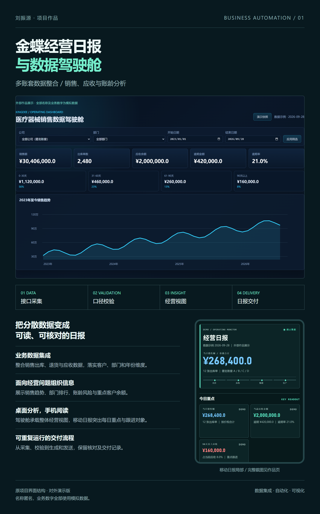

# lzy6610 · 经营日报与数据驾驶舱作品集

通过金蝶业务数据整合、销售与应收分析、移动日报交付，展示业务数字化项目的实施方法与界面成果。

这是原项目的**对外展示版本**。公司、客户和人员名称已匿名，金额、单据数量等业务数字均为模拟数据。仓库不包含生产接口、企业原始数据、登录凭据或后台服务；界面截图中的筛选控件仅用于展示。

## 作品内容

- 经营驾驶舱：销售与应收总览、跨年度趋势、部门排行、账龄结构和重点客户应收。
- 移动经营日报：今日重点、销售明细、账龄风险、部门与 KA 应收、客户余额。
- 实施流程：接口采集 → 口径统一与校验 → 经营视图 → 日报生成与交付。
- 9 张高清展示图：1 张作品总览、3 张驾驶舱、5 张移动日报切图。

## 查看与下载

- 网站入口：`index.html`。
- 完整移动日报演示：`daily-demo.html`。
- 高清图片：`assets/`。
- 全部图片下载：`portfolio-images.zip`。

直接打开 `index.html` 可在本地查看；页面包含图片放大、逐张下载与打包下载功能。

## 部署

项目为纯静态 HTML、CSS、JavaScript，无需安装依赖或运行构建。

### GitHub Pages

在仓库 Settings → Pages 中选择从分支发布，分支为 `main`，目录为根目录 `/`。

### 腾讯云 EdgeOne Pages

导入本仓库，选择静态网站/其他框架，跳过构建，将仓库根目录设置为发布目录。也可以将网站文件直接打包上传。

长期对外分享建议绑定自有域名。仓库目前未绑定或声称拥有任何自定义域名。

## 数据说明

作品页用于说明项目的业务流程、统计口径和展示方式，模拟数字不代表真实经营业绩。原生产系统与本展示仓库相互独立。
